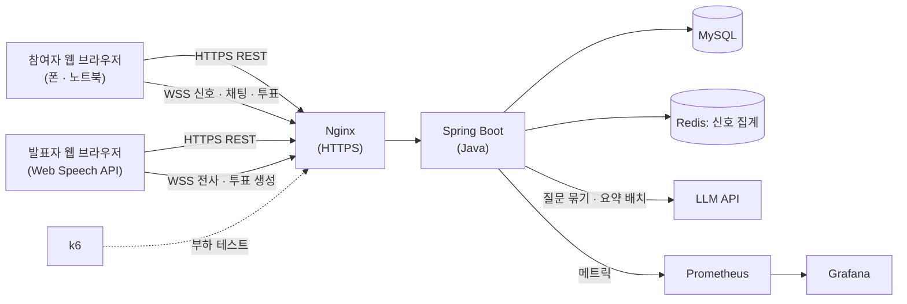

# RE:ACT — 기획서 요약

백엔드 12기 14회차 3팀. 제출용 기획서 중 개발에 필요한 부분만 남겼다. 기능 규칙은 `docs/feature-spec.md`, API 는 `docs/api-spec.md`, DB 는 `docs/db/erd.dbml` 을 본다. 일별 작업은 Jira 티켓이 기준이다.

## 1. 서비스 개요

- **이름**: RE:ACT (리액트). 청중의 반응에 강연자가 다시 행동한다는 뜻.
- **한 줄 소개**: 청중의 질문과 반응이 강연에 반영되도록 돕는 실시간 소통 플랫폼.
- **소개**: 청중은 QR 코드나 링크로 접속해 질문을 남기거나 '헷갈림' 버튼으로 이해 상태를 표현한다. 강연자는 대시보드에서 질문과 반응을 실시간으로 보고, 헷갈림이 몰리면 예시를 더 들어 설명한다. 강연 후에는 AI 가 유사한 의견을 묶고 요약한 보고서로 다음 강연에서 보완할 부분을 정한다.

## 2. 문제 정의와 차별점

- **문제**: 청중은 흐름을 끊기 부담스럽거나 타이밍을 놓쳐 질문을 못 하고, 실시간 채팅은 메시지가 쌓이면 중요한 질문이 묻힌다. 강연자는 발표 중 반응을 일일이 확인하기 어렵고, 끝난 뒤에는 어느 설명에서 나온 질문인지 떠올리기 어렵다.
- **기존 대안의 한계**: 손들기는 기록이 남지 않고, Zoom 채팅·반응은 어느 부분에서 나온 질문인지 확인이 어렵고, 클라썸은 실시간 이해도와 질문 집중 시간대를 연결한 회고 보고서를 제공하지 않는다.
- **차별점**: ① 이해도 반응과 질문을 시간대별로 연결, ② 반복 질문·주요 관심사를 AI 로 자동 정리, ③ 종료 후 회고 보고서 제공(발언 기록 STT 와 함께 확인), ④ 강연자의 추가 관리 부담 최소화.
- **주 사용자**: 실습형 강연을 하는 강사(예: 기업 신입 교육 강사). 보고서 첫 장은 "청중이 무엇을 더 알고 싶어 했나 / 어느 대목에서 보충이 필요했나 / 강연 후 무엇을 하면 좋을까"에 답한다. 같은 시간대라는 이유만으로 원인을 단정하지 않는다.

## 3. MVP 범위

| # | 기능 | 설명 |
| --- | --- | --- |
| 1 | 강연방 개설·청중 참여 | 강연자가 방을 열면 청중이 QR·링크로 접속해 질문·의견을 남기고 이해됨/헷갈림/모르겠음을 선택 |
| 2 | 강연자 실시간 대시보드 | 새 질문·의견과 시간대별 이해 상태를 한 화면에서 확인하고 설명을 보충 |
| 3 | AI 강연 회고 보고서 | 종료 후 유사 주제별로 청중 의견(질문·의견·요청·이해 부족 표현)을 그룹화·요약, 발언 기록(STT)과 청중 반응을 함께 확인 |

범위 밖(P2): 강연방 삭제, 채팅 삭제·신고·검색, 다양한 투표 유형, Redis Streams 분석 큐, 보고서 PDF·비교 분석, 음성 파일 재전사, 서버 확장 등 (`docs/feature-spec.md` §12).

사용자 시나리오:

- **청중**: QR 입장 → 실습 중 화면이 다르면 '헷갈림' → 흐름을 끊지 않고 질문 남김 → 강사가 설명하면 '이해됨'.
- **강연자**: 강연방 개설·QR 공유 → 대시보드에서 '헷갈림' 증가와 같은 시간대 질문을 확인 → 보충 설명 → 종료 후 보고서로 다음 수업 자료 보완.

## 4. 기술 스택

| 영역 | 기술 | 이유 |
| --- | --- | --- |
| 백엔드 | Java, Spring Boot, Spring Security, WebSocket | 기존 경험 활용, 실시간 채팅·이해도 처리, 강연자·청중 권한 구분 |
| DB | MySQL, Redis, Flyway | MySQL 에 강연·채팅·이해도 저장, Redis 는 실시간 버퍼·임시 상태 |
| 프론트 | React, TypeScript | 대시보드·청중 화면 분리, 모바일 반응형 |
| 인프라 | AWS EC2, Docker, Nginx | 한 도메인에서 REST·WSS 제공 |
| 기타 | GitHub Actions, Prometheus, Grafana, LLM API, Web Speech API | CI, 모니터링(P2), AI 분석, 브라우저 STT |

## 5. 아키텍처

학습 범위 밖 기술의 대응: WebSocket 은 기본 송수신부터 점진 확장, Redis Streams 는 간단한 검증 후 도입 여부 판단(P2), LLM API 는 배치 처리와 입력 토큰 제한으로 지연·비용 관리, STT 는 기술적 제약이 크면 대체하거나 후순위 조정.

## 6. 핵심 데이터 흐름

**청중이 '헷갈림'을 누를 때**
1. 서버가 참여 토큰으로 참여자를 식별하고 강연방이 LIVE 인지 확인한다.
2. `participant_understandings` 에 최신 상태를 저장(기존이 '이해됨'이면 '헷갈림'으로 갱신)하고 `understanding_histories` 에 이전 상태·새 상태·변경 시각을 기록한다.
3. 최신 상태 기준으로 집계를 갱신해 WebSocket 으로 대시보드에 전달한다(이해됨 −1, 헷갈림 +1, 전체 응답자 수 불변).

**강연 종료와 회고 보고서**
1. 종료 시 `lecture_rooms` 를 ENDED 로 바꾸고 종료 시각을 기록하며, 이후 새 채팅·이해도·투표 응답을 차단한다.
2. 보고서 생성 요청 시 마지막 전사·채팅의 저장 상태를 확인하고 `stt_segments`, `chat_messages`, `ai_topic_groups`, 이해도 이력, 투표 응답을 시간대별로 모은다.
3. 수집 데이터를 바탕으로 AI 회고 초안을 만든다. 전사가 누락된 구간은 '발언 기록 없음'으로 표시하고 같은 시간대의 질문·반응을 함께 제시한다.
4. 결과를 `lecture_reports` 에 저장한다. 조회 시에는 저장된 결과를 반환하고 LLM 을 다시 호출하지 않는다.

## 7. 외부 의존성

| 서비스 | 용도 | 비용 |
| --- | --- | --- |
| LLM API (기획서 기준 OpenAI, 모델은 비용·품질로 결정) | 청중 채팅 주제 그룹화·요약, 회고 보고서 | 토큰 기반. 배치·입력 제한으로 관리 |
| Web Speech API | 강연자 음성을 텍스트로 변환 | 브라우저 기능. 브라우저·인식 서비스별 제약 존재 |

비용 추정(1시간 강연, AI 채팅 분석 + 보고서 1회 기준): Gemini 2.5 Flash-Lite 10회 $0.05 / 1,000회 $5.20, GPT-5.4 nano $0.13 / $13.33, Gemini 2.5 Flash $0.24 / $24.05, GPT-5.4 mini $0.49 / $48.75.

## 8. 일정

| 주차 | 기간 | 목표 | 배포 상태 |
| --- | --- | --- | --- |
| 1주 | 11/16~11/22 | 공통 계약 확정, 인증·강연방·채팅·이해도·투표 기본, AI·STT 기술 검증 | 기본 기능 부분 배포 |
| 2주 | 11/23~11/29 | 도메인별 P0 완성, AI 의견 분석, STT 기록, 대시보드, 회고 보고서 통합 | P0 MVP 공개 배포 (11/29) |
| 3주 | 11/30~12/6 | 정합성·권한·AI 품질·STT 누락 검증, 오류 수정, 최종 배포·발표 준비 | 최종 배포 (12/4), 발표 (12/7) |

주말 포함 작업. 일별 상세 작업은 Jira 스프린트(1주차·2주차·3주차)의 티켓을 본다.

**역할**: A 백한비(AUTH·ROOM·POLL·OPS), B 신종현(CHAT·FEED·DASH-01~03), C 박세민(AI-CHAT·DASH-04~05), D 문창원(STT·REPORT).

**역할 간 연동**: 보고서 입력 데이터가 누락되거나 형식이 다르면 해당 데이터를 제공하는 A·B·C 가 각자 수정한다.

| 제공 | 데이터·API | 사용 | 계약 확정 | 연동 목표 |
| --- | --- | --- | --- | --- |
| A | `roomId`, 방 상태, 강연 시작·종료 시각, 참가자 식별 | B·C·D | 11/17 | 11/20 |
| A | 투표·선택지·투표 응답·결과 | B(대시보드)·D | 11/18 | 11/25 |
| B | 채팅 메시지·작성자·`receivedAt` | C·D | 11/17 | 11/19 |
| B | 이해도 최신 상태·이력·집계값 | D | 11/18 | 11/24 |
| C | `topic`, `category`, `summary`, `sourceMessageIds` | D | 11/17 | 11/25 |
| D | STT 발언·시각·누락 구간 | D(보고서 처리) | 11/17 | 11/24 |
| D | 회고 보고서 생성 상태·결과 JSON | 보고서 화면 | 11/20 | 11/28 |

## 9. 배포

| 항목 | 내용 |
| --- | --- |
| 백엔드 | AWS EC2 1대(t3.small 기준), Docker Compose 로 Spring Boot·Redis·모니터링 실행 |
| 프론트 | 같은 EC2 의 Nginx 가 빌드 결과를 제공, 한 도메인에서 REST·WSS 처리 |
| DB | EC2 의 MySQL Docker 컨테이너 |
| 도메인 | 사용 (구매 시 확정) |
| CI/CD | GitHub Actions: PR 마다 빌드·테스트, main 병합 시 EC2 배포 |
| 비용 | EC2 약 월 $20 + 도메인 연 1~2만원 + LLM 월 수 달러 이내. 메모리 부족 시 t3.medium(월 약 $40) |

## 10. 리스크

| # | 리스크 | 가능성 | 영향 | 대응 |
| --- | --- | --- | --- | --- |
| 1 | LLM 호출 비용 초과 | 중 | 상 | 일정 주기 배치 분석, 중복·도배 제거로 입력 토큰 최소화, 강연별 토큰·비용 상한과 초과 시 분석 중단 |
| 2 | 채팅 트래픽으로 인한 부하·지연 | 중 | 상 | 채팅 처리와 AI 분석을 비동기로 분리, Redis 에 분석 대상 임시 저장, 부하 테스트로 검증 |
| 3 | LLM 응답 지연·주요 질문 누락 | 상 | 상 | 30초 단위 분석, 명백한 노이즈만 제거, 지연 시 이전 결과 유지, 테스트 데이터로 정확도·응답 시간 검증 |

## 11. 성공 기준

공식 DoD: 공개 서비스 URL 운영, 공개 GitHub 저장소, README(소개·스택·실행법·아키텍처), 데모 영상 3~5분.

기능별 완료 기준은 `docs/feature-spec.md` §14 를 따른다. 최종 완료 기준: 강연자가 강연방을 열고, 청중이 실시간으로 질문·의견·이해도를 전달하며, 강연자가 대시보드로 확인할 수 있어야 한다. 종료 후 실제 수집 데이터로 AI 회고 보고서가 생성되고, 강연자가 조회해 다음 강연의 개선 자료로 쓸 수 있어야 한다(내용 수정·저장은 P1 REPORT-10). 데이터 정합성, AI 분석의 신뢰성, 실제 사용자 피드백까지 확인한 상태를 완료로 본다.

3주 차 완료 기준: 전체 P0 정상 동작, 10~20명 모의 강연 통합 테스트, 권한·격리·집계 정합성 검증, AI 결과가 실제 메시지와 연결, STT 누락이 보고서에서 임의로 보완되지 않음, 보고서가 원천 데이터와 AI 제안을 구분, 최종 공개 URL·README·데모 영상 준비.
