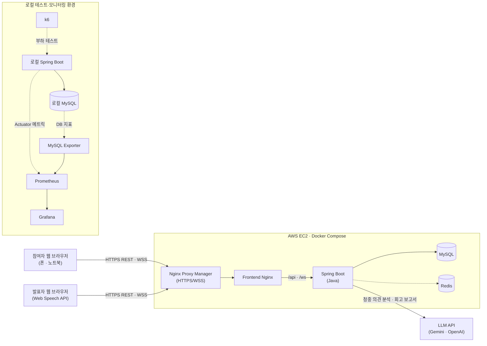

# RE:ACT — 기획서 요약

백엔드 12기 14회차 3팀. 제출용 기획서 중 개발에 필요한 부분만 남겼다. 기능 규칙은 `docs/feature-spec.md`, API 는 `docs/api-spec.md`, DB 는 `docs/db/erd.dbml` 을 본다. 일별 작업은 Jira 티켓이 기준이다.

## 1. 서비스 개요

- **이름**: RE:ACT (리액트). 청중의 반응에 강연자가 다시 행동한다는 뜻.
- **한 줄 소개**: 청중의 질문과 반응이 강연에 반영되도록 돕는 실시간 소통 플랫폼.
- **소개**: 청중은 QR 코드나 링크로 접속해 질문을 남기거나 이해도 체크에 응답한다. 강연자는 대시보드에서 질문과 반응을 실시간으로 보고, 헷갈림이 몰리면 예시를 더 들어 설명한다. 강연 후에는 AI 가 유사한 의견을 묶고 요약한 보고서로 다음 강연에서 보완할 부분을 정한다.

## 2. 문제 정의와 차별점

- **문제**: 청중은 흐름을 끊기 부담스럽거나 타이밍을 놓쳐 질문을 못 하고, 실시간 채팅은 메시지가 쌓이면 중요한 질문이 묻힌다. 강연자는 발표 중 반응을 일일이 확인하기 어렵고, 끝난 뒤에는 어느 설명에서 나온 질문인지 떠올리기 어렵다.
- **기존 대안의 한계**: 손들기는 기록이 남지 않고, Zoom 채팅·반응은 어느 부분에서 나온 질문인지 확인이 어렵고, 클라썸은 실시간 이해도와 질문 집중 시간대를 연결한 회고 보고서를 제공하지 않는다.
- **차별점**: ① 이해도 반응과 질문을 시간대별로 연결, ② 반복 질문·주요 관심사를 AI 로 자동 정리, ③ 종료 후 회고 보고서 제공(발언 기록 STT 와 함께 확인), ④ 강연자의 추가 관리 부담 최소화.
- **주 사용자**: 실습형 강연을 하는 강사(예: 기업 신입 교육 강사). 보고서 첫 장은 "청중이 무엇을 더 알고 싶어 했나 / 어느 대목에서 보충이 필요했나 / 강연 후 무엇을 하면 좋을까"에 답한다. 같은 시간대라는 이유만으로 원인을 단정하지 않는다.

## 3. MVP 범위

| # | 기능 | 설명 |
| --- | --- | --- |
| 1 | 강연방 개설·청중 참여 | 강연자가 방을 열면 청중이 QR·링크로 접속해 질문·의견을 남기고, 이해도 체크가 열리면 이해됨/헷갈림/모르겠음을 선택 |
| 2 | 강연자 실시간 대시보드 | 새 질문·의견과 시간대별 이해 상태를 한 화면에서 확인하고 설명을 보충 |
| 3 | AI 강연 회고 보고서 | 종료 후 유사 주제별로 청중 의견(질문·의견·요청·이해 부족 표현)을 그룹화·요약, 발언 기록(STT)과 청중 반응을 함께 확인 |

강연자는 홈에서 준비 중인 자기 방을 삭제할 수 있다. 대기 중인 청중은 삭제 알림을 받고 자동 퇴장한다. 채팅 삭제·신고·검색, 다양한 투표 유형, Redis Streams 분석 큐, 보고서 PDF·비교 분석, 음성 파일 재전사, 서버 확장은 추후 범위다. [기능 명세](feature-spec.md)

사용자 시나리오:

- **청중**: QR 입장 → 강연 참여 → 이해도 체크에서 '헷갈림' 선택 → 흐름을 끊지 않고 질문 남김 → 보충 설명 후 이해 상태 변경 또는 다음 이해도 체크에 응답.
- **강연자**: 강연방 개설·QR 공유 → 대시보드에서 '헷갈림' 증가와 같은 시간대 질문을 확인 → 보충 설명 → 종료 후 보고서로 다음 수업 자료 보완.

### 초기 서비스 운영 범위

| 항목 | 기본 운영 제한 |
| --- | --- |
| 전체 동시 LIVE 강연방 | 6개 |
| 강연자당 동시 LIVE 강연방 | 1개 |
| 강연방당 최대 등록 청중 | 50명 |
| 전체 LIVE 강연방 최대 등록 청중 | 300명(6개 × 50명, 파생값) |
| 최대 강연 시간 | 180분 |

서버에서 동시 강연방 수 및 신규 청중 정원을 검증하고, 최대 강연 시간에 도달한 LIVE 강연방을 자동 종료한다.

전체 청중 300명은 기본 운영 설정에 따른 파생 규모이며 별도의 절대 상한 검사는 없다. 실제 동시 사용자 처리 성능이 검증되었다는 의미는 아니다.

채팅 길이 300자 및 사용자별 초당 2건 전송 제한은 추가 구현 목표다. 성능 및 안정성 목표는 [기능 정의서](feature-spec.md) §15 를 따른다.

## 4. 기술 스택

| 영역 | 기술 | 이유 |
| --- | --- | --- |
| 백엔드 | Java 25, Spring Boot, Spring Security, WebSocket/STOMP | 기존 경험 활용, 실시간 채팅·이해도 처리, 강연자·청중 권한 구분 |
| DB | MySQL 8.4, Redis 7.4, Flyway | MySQL 에 강연·채팅·투표·STT·AI 분석·보고서 저장, Redis 연동, 스키마 버전 관리 |
| 프론트 | React, Vite, JavaScript | 대시보드·청중 화면 분리, 모바일 반응형 |
| 인프라 | AWS EC2, Terraform, Docker Compose, Nginx, Nginx Proxy Manager | 인프라 구성 관리, 단일 도메인에서 REST·WSS 제공 |
| CI/CD | GitHub Actions, GHCR, AWS SSM | 자동 테스트·이미지 게시·운영 배포 |
| 테스트·모니터링 | JUnit, MockMvc, k6, Prometheus, Grafana | 기능 검증, 동시성 검증, 부하 테스트 및 병목 분석 |
| 기타 | Gemini API, OpenAI API, Web Speech API | 청중 의견 분석, 회고 보고서 생성, 브라우저 STT |

## 5. 아키텍처

운영 서버는 단일 EC2에서 Docker Compose로 실행하며, Nginx Proxy Manager에서 HTTPS/WSS를 처리한다.

Prometheus·Grafana는 현재 로컬 개발 및 부하 테스트 환경에서 사용한다. 위 모니터링 구성은 운영 EC2에 배포된 구성을 의미하지 않는다.

학습 범위 밖 기술의 대응: WebSocket 은 기본 송수신부터 점진 확장, Redis Streams 는 간단한 검증 후 도입 여부 판단(P2), LLM API 는 배치 처리와 입력 토큰 제한으로 지연·비용 관리, STT 는 기술적 제약이 크면 대체하거나 후순위 조정.

## 6. 핵심 데이터 흐름

**강연 시작과 청중 입장**
1. 강연자가 READY 상태의 강연방을 생성하고 QR 또는 참여 링크를 공유한다.
2. 청중은 닉네임과 참여 코드를 사용하여 입장하며, 서버는 방별 참여자 식별 정보 및 인증 쿠키를 발급한다.
3. 신규 참여자를 저장하기 전에 강연방 행을 잠그고 등록 청중 정원을 확인한다. 동일 입장 키 또는 유효한 기존 참여 쿠키는 기존 참여자를 재사용한다.
4. 강연 시작 요청 시 해당 방의 소유권, READY 상태, 전체 및 강연자별 LIVE 강연방 수를 확인한다.
5. 공통 잠금 행을 사용하여 동시 시작 요청에서도 운영 제한을 초과하지 않도록 한다.
6. 시작 성공 시 `lecture_rooms` 를 LIVE 로 변경하고 시작 시각 및 상태 변경 이벤트를 기록한다.

**강연자가 이해도 체크를 열고 청중이 '헷갈림'을 누를 때**
1. 강연자가 이해도 체크(`polls.type=UNDERSTANDING`)를 연다. 서버가 제한 시간(기본 60초)으로 `closes_at` 을 계산하고, 열린 투표가 이미 있으면 거절한다. 청중에게 투표 열림 이벤트를 보낸다.
2. 청중이 선택하면 서버가 참여 토큰으로 참여자를 식별하고 강연방이 LIVE 이며 투표가 마감 전인지 확인한다.
3. `poll_responses` 에 청중당 최종 응답 한 건을 저장한다. 마감 전에 '이해됨'에서 '헷갈림'으로 바꾸면 같은 행을 덮어쓰고 이력은 남기지 않는다.
4. 최종 응답 기준으로 집계를 갱신해 WebSocket 으로 강연자에게만 전달한다(청중에게는 결과를 보내지 않는다).
5. `closes_at` 이 지나면 서버 스케줄러가 투표를 마감하고, 마지막 선택이 최종 응답이 된다. 선택하지 않은 청중은 미응답으로 남는다.

**강연 종료와 회고 보고서**
1. 강연자의 종료 요청 또는 최대 강연 시간에 따른 자동 종료 시 `lecture_rooms` 를 ENDED 로 바꾸고 종료 시각을 기록하며, 이후 새 채팅·투표 응답(이해도 체크 포함)을 차단하고 열린 투표와 STT 세션을 종료한다.
2. 강연 종료 후 보고서 한 건을 자동 접수하고 마지막 청중 분석 확정 등 생성 조건을 확인한다. `stt_segments`, `chat_messages`, `ai_topic_groups`, 이해도 체크 결과, 투표 응답을 시간대별로 모은다.
3. 수집 데이터를 바탕으로 AI 회고 초안을 만든다. 전사가 누락된 구간은 '발언 기록 없음'으로 표시하고 같은 시간대의 질문·반응을 함께 제시한다.
4. 결과를 `lecture_reports` 에 저장한다. 조회 시에는 저장된 결과를 반환하고 LLM 을 다시 호출하지 않는다.

## 7. 외부 의존성

| 서비스 | 용도 | 비용 |
| --- | --- | --- |
| LLM API(Gemini, OpenAI) | 청중 채팅 주제 그룹화·요약, 회고 보고서 | 토큰 기반. 배치·입력 제한으로 관리 |
| Web Speech API | 강연자 음성을 텍스트로 변환 | 브라우저 기능. 브라우저·인식 서비스별 제약 존재 |

초기 기획 당시 비용 추정(1시간 강연, AI 채팅 분석 + 보고서 1회 기준): Gemini 2.5 Flash-Lite 10회 $0.05 / 1,000회 $5.20, GPT-5.4 nano $0.13 / $13.33, Gemini 2.5 Flash $0.24 / $24.05, GPT-5.4 mini $0.49 / $48.75.

위 비용은 초기 비교용 추정치이며 실제 운영 모델의 가격이나 최종 청구 비용을 의미하지 않는다. 실제 호출량·토큰 사용량·설정된 모델 단가를 기준으로 비용을 측정한다.

## 8. 일정

| 주차 | 기간 | 목표 | 배포 상태 |
| --- | --- | --- | --- |
| 1주 | 11/16~11/22 | 공통 계약 확정, 인증·강연방·채팅·이해도·투표 기본, AI·STT 기술 검증 | 기본 기능 부분 배포 |
| 2주 | 11/23~11/29 | 도메인별 P0 완성, AI 의견 분석, STT 기록, 대시보드, 회고 보고서 통합 | P0 MVP 공개 배포 (11/29) |
| 3주 | 11/30~12/6 | 정합성·권한·AI 품질·STT 누락 검증, 오류 수정, 최종 배포·발표 준비 | 최종 배포 (12/4), 발표 (12/7) |

주말 포함 작업. 일별 상세 작업은 Jira 스프린트(1주차·2주차·3주차)의 티켓을 본다.

**역할**: A 백한비(AUTH·ROOM·POLL-01~03·OPS), B 신종현(CHAT·POLL-05~07 이해도 체크·DASH-01~03), C 박세민(AI-CHAT·DASH-04~05), D 문창원(STT·REPORT).

**역할 간 연동**: 보고서 입력 데이터가 누락되거나 형식이 다르면 해당 데이터를 제공하는 A·B·C 가 각자 수정한다.

| 제공 | 데이터·API | 사용 | 계약 확정 | 연동 목표 |
| --- | --- | --- | --- | --- |
| A | `roomId`, 방 상태, 강연 시작·종료 시각, 참가자 식별 | B·C·D | 11/17 | 11/20 |
| A | 투표·선택지·투표 응답·결과(이해도 체크 `type=UNDERSTANDING` 포함) | B(대시보드·이해도 체크)·D | 11/18 | 11/25 |
| B | 채팅 메시지·작성자·`receivedAt` | C·D | 11/17 | 11/19 |
| B | 이해도 체크 라운드 결과·집계값(`understandingChecks`) | D | 11/18 | 11/24 |
| C | `topic`, `category`, `summary`, `sourceMessageIds` | D | 11/17 | 11/25 |
| D | STT 발언·시각·누락 구간 | D(보고서 처리) | 11/17 | 11/24 |
| D | 회고 보고서 생성 상태·결과 JSON | 보고서 화면 | 11/20 | 11/28 |

## 9. 배포

| 항목 | 내용 |
| --- | --- |
| 백엔드 | AWS EC2 1대, Terraform 기본값 t3.medium(2 vCPU, 4GiB RAM), Docker Compose 로 실행 |
| 프론트 | 같은 EC2 의 Nginx 가 빌드 결과를 제공, 한 도메인에서 REST·WSS 처리 |
| DB | EC2 의 MySQL·Redis Docker 컨테이너 |
| 인프라 | Terraform으로 VPC·서브넷·보안 그룹·EC2·탄력적 IP 등 관리 |
| 디스크 | Terraform 기본 Root EBS 20GiB |
| 도메인 | https://www.re-act.site |
| HTTPS | Nginx Proxy Manager 및 Let's Encrypt |
| CI/CD | GitHub Actions에서 develop/main 대상 PR 검증, main Push 시 CI 재검증 및 GHCR·AWS SSM을 통한 EC2 자동배포 |
| 모니터링 | 로컬 Prometheus·Grafana·MySQL Exporter 구성, 운영 배포 및 외부 알림은 별도 검증 |
| 비용 | EC2·EBS·공인 IP·도메인·LLM 사용량 등을 기준으로 실제 비용 확인 |

초기 기획은 `t3.small`을 기준으로 EC2 월 약 $20, 도메인 연 1~2만원, LLM 월 수 달러 이내를 예상했으며, 메모리가 부족할 경우 `t3.medium`(월 약 $40)을 검토했다.

현재 Terraform의 기본 인스턴스 타입은 `t3.medium`이다. 실제 적용된 운영 인스턴스 사양과 청구 비용은 AWS에서 확인한다.

자세한 구성 및 배포 절차는 [AWS 운영 배포 가이드](aws/deployment.md)를 따른다.

## 10. 리스크

| # | 리스크 | 가능성 | 영향 | 대응 |
| --- | --- | --- | --- | --- |
| 1 | LLM 호출 비용 초과 | 중 | 상 | 일정 주기 배치 분석, 중복·도배 제거로 입력 토큰 최소화, 호출량·입력량 제한 및 사용량 측정 |
| 2 | 채팅 트래픽으로 인한 부하·지연 | 중 | 상 | 채팅 처리와 AI 분석을 비동기로 분리, 강연방별 채팅 배치 전송, 부하 테스트로 검증 |
| 3 | LLM 응답 지연·주요 질문 누락 | 상 | 상 | 30초 단위 분석, 명백한 노이즈만 제거, 지연 시 이전 결과 유지, 테스트 데이터로 정확도·응답 시간 검증 |
| 4 | 동시 강연 시작 및 청중 입장 시 운영 제한 초과 | 중 | 상 | 공통 잠금 행 및 강연방 행 잠금, READ_COMMITTED 트랜잭션으로 제한 검증 및 상태 변경 처리 |
| 5 | 장시간 강연으로 인한 서버 자원 점유 | 중 | 상 | 최대 강연 시간 제한 및 자동 종료, 장시간 부하 테스트 |
| 6 | 단일 EC2 환경의 CPU·메모리·DB 커넥션 부족 | 중 | 상 | 운영 규모 제한, Prometheus·Grafana로 병목 확인, 부하 테스트 결과를 기준으로 최적화 |
| 7 | 자동 종료 직전 STT 미전송 기록 누락 | 중 | 상 | 만료 전 안내 및 마지막 전사 저장 순서 후속 협의, 서버에 저장된 기록과 누락 구간 구분 |

## 11. 성공 기준

공식 DoD: 공개 서비스 URL 운영, 공개 GitHub 저장소, README(소개·스택·실행법·아키텍처), 데모 영상 3~5분.

기능별 완료 기준은 `docs/feature-spec.md` §13 를 따른다. 최종 완료 기준: 강연자가 강연방을 열고, 청중이 실시간으로 질문·의견·이해도를 전달하며, 강연자가 대시보드로 확인할 수 있어야 한다. 종료 후 실제 수집 데이터로 AI 회고 보고서가 생성되고, 강연자가 조회해 다음 강연의 개선 자료로 쓸 수 있어야 한다(내용 수정·저장은 P1 REPORT-10). 데이터 정합성, AI 분석의 신뢰성, 실제 사용자 피드백까지 확인한 상태를 완료로 본다.

3주 차 완료 기준: 전체 P0 정상 동작, 10~20명 모의 강연 통합 테스트, 권한·격리·집계 정합성 검증, AI 결과가 실제 메시지와 연결, STT 누락이 보고서에서 임의로 보완되지 않음, 보고서가 원천 데이터와 AI 제안을 구분, 최종 공개 URL·README·데모 영상 준비.

추가 운영 검증 기준:

- 운영 제한의 경계값 및 동시성 테스트
- 전체 백엔드 회귀 테스트 및 CI 검증
- 1개·3개·6개 강연방의 단계별 부하 테스트
- 최대 운영 목표인 6개 강연방 × 50명 환경에서의 복합 부하 검증
- 여러 강연방의 동시 종료 및 보고서 생성 검증
- 장시간 강연의 메모리·DB·WebSocket 안정성 검증
- [기능 정의서](feature-spec.md) §15 의 성능·안정성·정합성 목표 충족 여부 확인

10~20명 모의 강연은 기능과 사용자 흐름을 확인하는 기준이며, 최대 운영 규모의 성능 검증은 별도로 수행한다.
